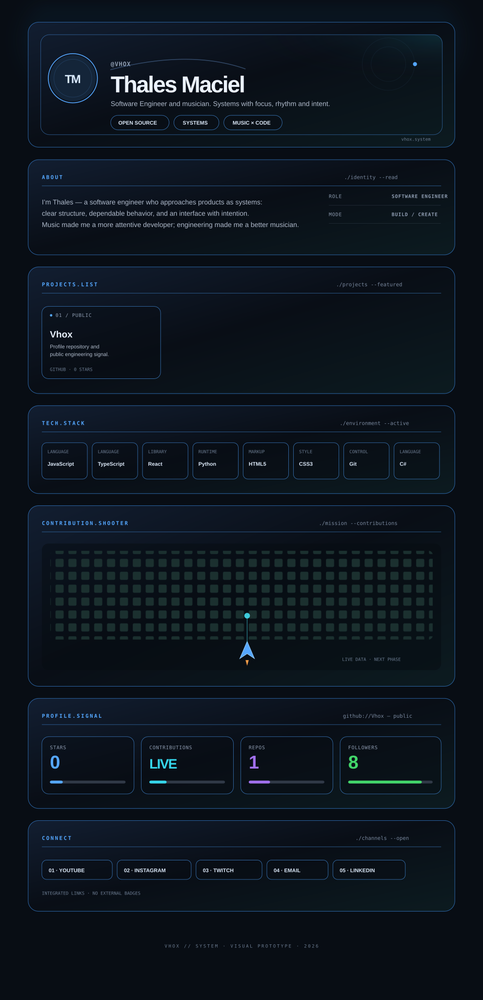

  

  <a href="https://www.youtube.com/@macielthales">YouTube</a>
  &nbsp;·&nbsp;
  <a href="https://www.instagram.com/thalesmacciel">Instagram</a>
  &nbsp;·&nbsp;
  <a href="https://www.twitch.tv/vhoxzera">Twitch</a>
  &nbsp;·&nbsp;
  <a href="mailto:thales.mac@gmail.com">Email</a>
  &nbsp;·&nbsp;
  <a href="https://www.linkedin.com/in/thales-maciel-b8466a173">LinkedIn</a>

 

  

<!--
  VHOX // SYSTEM
  Visual panels are intentionally static, self-contained SVG so GitHub can render them safely.
  The existing snake remains in place until the contribution shooter is implemented with live data.
-->
